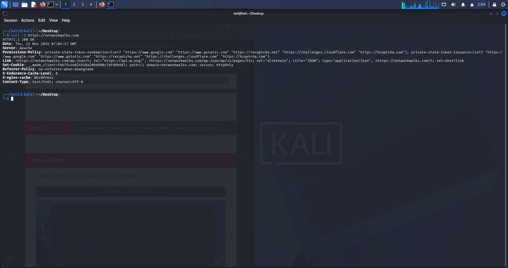
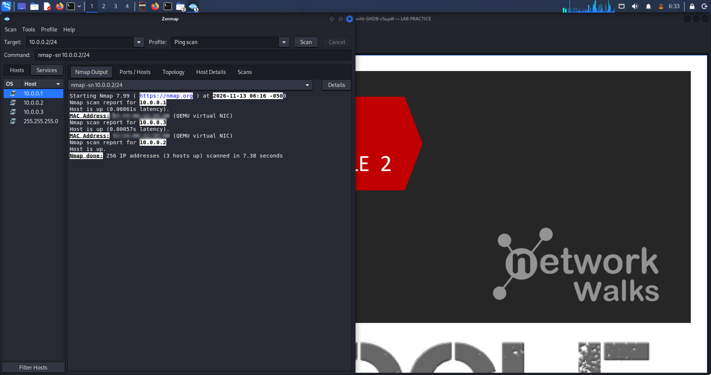
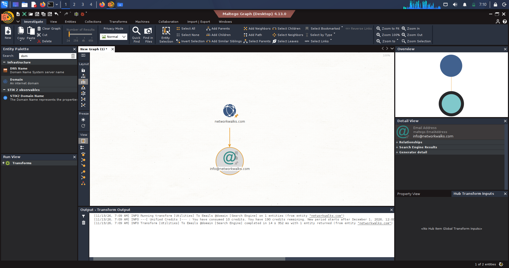

# Cybersecurity & Ethical Hacking: Week 2 Report
**Topics Covered:** Footprinting, Reconnaissance, and Network Scanning
**Environment:** Kali Linux, Linux Mint, Windows (Zenmap)

## 1. Liability Disclaimer
I confirm that all activities detailed in this report were conducted strictly within a controlled, educational environment. For the external target (`networkwalks.com`), explicit written permission was secured prior to any reconnaissance. The network scanning tasks were performed exclusively on my own local network and devices. All techniques demonstrated here are intended solely for educational and defensive research purposes. I understand that unauthorized access or scanning is illegal, and I take full responsibility for my actions. The instructors, authors, and Networkwalks bear no liability for any misuse of this information.

## 2. Introduction
This report documents the practical exercises completed during Week 2 of my Cybersecurity & Ethical Hacking internship. The focus of this module was on the initial phases of a security assessment: Footprinting, Reconnaissance, and Network Scanning. 

The tasks were divided into five practical modules:
*   **Module 1:** Passive footprinting of `networkwalks.com` using standard Kali Linux terminal tools.
*   **Module 2:** Utilizing Google Hacking Database (GHDB) dorks to locate exposed devices and files.
*   **Module 3:** Harvesting organizational email addresses using Maltego.
*   **Module 4:** Gathering emails and sub-domains using theHarvester.
*   **Module 5:** Mapping my local network using Zenmap (Nmap GUI).

Together, these exercises demonstrate how an attacker transitions from gathering publicly available data to actively mapping a network's live hosts, emphasizing why minimizing the public attack surface is critical for defenders.

## 3. Tools Utilized
The following table outlines the tools used throughout this project and their specific roles:

| Tool | Purpose / Function |
| --- | --- |
| **Kali Linux / Linux Mint** | Operating systems used to host the reconnaissance and scanning tools. |
| **WHOIS** | Queried domain registration data (registrar, creation/expiry dates, name servers). |
| **WhatWeb** | Fingerprinted the web stack (CMS, plugins, server version, and IP). |
| **Nslookup** | Resolved the target domain to its numerical IP address via DNS. |
| **Curl -I** | Extracted HTTP response headers to identify server banners and exposed endpoints. |
| **Wafw00f** | Detected the presence of a Web Application Firewall (WAF). |
| **DNSRecon** | Enumerated DNS records (MX, NS, TXT, SPF, SRV) to map the infrastructure. |
| **GHDB (Exploit-DB)** | Provided Google search operators (dorks) to find exposed cameras and documents. |
| **Maltego** | Conducted an email domain search to map out organizational contacts. |
| **theHarvester** | Harvested emails and sub-domains from public search engines and databases. |
| **Zenmap (Nmap)** | Performed network discovery (Ping Sweep) to find live hosts on the local LAN. |

## 4. Activities Performed

### 4.1 Footprinting & Reconnaissance (Module 1)
Using a Kali Linux terminal, I profiled the target `networkwalks.com` using six distinct tools to build a comprehensive public profile:
*   **WHOIS:** Revealed the domain registration details. The name servers pointed to HostGator, instantly exposing the hosting provider.

  
  

*   **WhatWeb:** Identified the underlying technologies, notably that the site runs on **WordPress 7.0.4** and uses **WP Download Manager 3.3.58**. This is highly valuable for an attacker looking up known vulnerabilities for those specific versions.

  

*   **Nslookup:** Resolved the domain to the IP address **192.232.216.135**, allowing an attacker to scan the server directly without relying on the domain name.

  

*   **Curl -I:** Displayed HTTP response headers, exposing the WordPress REST API endpoint (`/wp-json/`) and confirming the Apache server.

  

*   **Wafw00f:** Detected that the site is protected by **ModSecurity (SpiderLabs)**. Knowing a WAF is present tells an attacker they must adjust their payloads to avoid being blocked.

  

*   **DNSRecon:** Enumerated the full DNS footprint, uncovering mail servers, the DNS software version (Bind 9.16.23), SPF policies, and cPanel SRV records.

  

### 4.2 Network Scanning with Zenmap (Module 5)
To understand internal network visibility, I installed Zenmap on my Linux Mint machine. 
1.  First, I used the `ipconfig` command to identify my local subnet.
2.  I then launched Zenmap, inputted my subnet, and ran a **Ping Scan** (`nmap -sn`).
3.  The scan identified **4 live hosts** (including my own PC). I recorded their IP addresses and their corresponding MAC addresses.
4.  Finally, I navigated to the **Topology** tab, enabled the legend, and exported the visual network map as a PDF for my final report.

### 4.3 Google Dorking via GHDB (Module 2)
Using the Google Hacking Database on Exploit-DB, I searched for the keyword "cam" to find viable Google Dorks. I then tested these dorks on Google. I successfully identified 10 exposed CCTV camera interfaces that were publicly accessible. I also utilized GHDB to locate dorks (such as `intitle:index.of "parent directory" mathematics pdf`) which helped me find open directories containing downloadable mathematics e-books. 

### 4.4 Email Domain Search using Maltego (Module 3)
After installing Maltego on a Windows environment, I ran a footprinting transform on the domain `networkwalks.com`. By dragging the "Domain" entity into the graph and running email-related transforms, the tool successfully harvested associated email addresses, providing a list of potential targets for social engineering or phishing.

### 4.5 Email & Sub-domain Harvesting with theHarvester (Module 4)
Using theHarvester in Kali Linux, I targeted `microsoft.com` to see how public data sources leak organizational data. 
*   **Task 1:** I ran the command `theHarvester -d microsoft.com -l 1000 -b baidu`. This queried Baidu and returned a list of emails and hosts.
*   **Task 2:** I ran the same tool using all available sources (`-b all`) with a limit of 50. This aggregated data from numerous search engines and databases, significantly expanding the list of sub-domains and email addresses linked to the target.

## 5. Risk Analysis & Impact
The data gathered during these exercises highlights several security risks. *Note: These are observations from information gathering; no exploitation was performed.*

| # | Finding | Evidence | Potential Impact | Risk Level |
| ---: | --- | --- | --- | :---: |
| 1 | **Exposed CMS & Plugins** | WhatWeb identified WordPress & WP Download Manager versions. | Attackers can cross-reference versions with public exploit databases to launch targeted attacks. | **Medium** |
| 2 | **Public IP Disclosure** | Nslookup revealed the server IP (192.232.216.135). | Allows attackers to bypass DNS and scan the server directly, mapping the hosting infrastructure. | **Low** |
| 3 | **Detailed HTTP Headers** | Curl exposed the `/wp-json/` endpoint. | Leaks technical architecture, giving attackers hidden entry points to probe. | **Low** |
| 4 | **WAF Identification** | Wafw00f identified ModSecurity. | Reveals the defensive architecture; attackers may attempt specific WAF bypass techniques rather than naive attacks. | **Low** |
| 5 | **Leaked DNS Infrastructure** | DNSRecon revealed mail servers, SPF, and Bind versions. | Provides a map of the email infrastructure, which can be used for spoofing or phishing campaigns. | **Medium** |
| 6 | **Exposed IoT Devices** | GHDB dorks revealed open CCTV camera feeds. | Severe privacy breaches; unauthorized parties can view live video feeds or exploit camera firmware. | **High** |
| 7 | **Local Network Visibility** | Zenmap mapped 4 live hosts on the LAN. | If unknown devices are present, they could be rogue access points or compromised machines acting as an entry point. | **Medium** |

## 6. Recommendations
Based on the footprinting and scanning results, I recommend the following defensive measures:
1.  **Minimize Public Exposure:** Remove or mask version numbers from web headers and public-facing technologies where possible.
2.  **Patch Management:** Keep CMS platforms (like WordPress) and their plugins updated to prevent the exploitation of known, public vulnerabilities.
3.  **Secure IoT & Open Directories:** Ensure that IP cameras and internal file directories are never exposed to the public internet. Implement strong authentication and network segmentation.
4.  **DNS Hygiene:** Regularly audit DNS records. Ensure that TXT/SPF records are configured strictly to prevent email spoofing, and hide unnecessary service records.
5.  **Regular Internal Audits:** Conduct routine network scans (like the Zenmap ping sweep) to maintain an accurate inventory of live hosts. Any unauthorized device should be immediately isolated and investigated.
6.  **WAF Tuning:** Keep the Web Application Firewall (ModSecurity) enabled, updated, and tuned to block automated scanning and common web attacks.

## 7. Conclusion
During Week 2, I gained hands-on experience with the reconnaissance and scanning phases of ethical hacking. By utilizing a suite of tools—from WHOIS and DNSRecon to GHDB, Maltego, and theHarvester—I learned how much sensitive information organizations inadvertently expose to the public. Furthermore, using Zenmap demonstrated how easily an attacker can pivot from external information gathering to internal network discovery.

A key takeaway from this module is that passive reconnaissance is highly stealthy; the target remains completely unaware that they are being profiled. This highlights the importance of the defender's role: organizations must routinely run these exact same tools against their own infrastructure to discover what they are leaking and lock it down before a malicious actor finds it. All activities were conducted ethically, reinforcing that technical skills must always be paired with strict legal authorization.